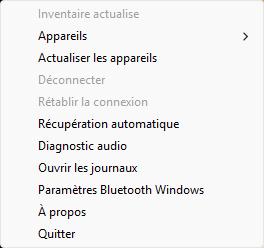

# AudioBridge

A small, local Windows Bluetooth audio receiver written in Rust. AudioBridge uses the Windows A2DP Sink API and lives in the notification area: **right-click the icon to control it**. No account, cloud service, telemetry, or automatic startup.

**Status: early community preview (0.3).** An open connection is not proof of audible audio. Bluetooth recovery and latency still depend on Windows, the adapter driver, and the source device. This is not a promise of better stability than every existing receiver.

[Français](README.fr.md) · [Diagnostics](DIAGNOSTICS.md) · [Privacy](PRIVACY.md) · [Contributing](CONTRIBUTING.md)



## Run

Extract the portable Windows x64 package and launch **AudioBridge.exe**. No administrator privileges are required for normal use. If Windows hides the icon, look in the notification-area overflow (the small arrow near the clock).

Pair the phone in Windows Bluetooth settings first. Right-click AudioBridge, refresh devices, and select the source to connect. Select the PC as the phone's media output and start playback.

The menu provides device selection, refresh, disconnect, rebuild connection, optional recovery, a local audio diagnostic, logs, Windows Bluetooth settings, About, and Quit. The interface is currently French. There is no browser window or console in the tray application. Quit explicitly closes its session; it does not leave a service running.

**Automatic recovery is off on every launch.** When enabled it retries a failed/closed session at most three times with 2/4/8-second delays per explicit request. It does not reconnect merely because the stream is silent. A slow operation runs on a separate owner thread; the menu stays responsive, but Quit can wait for the current Windows operation to finish.

## Requirements and limits

- Windows with `Windows.Media.Audio.AudioPlaybackConnection` (introduced in Windows 10 version 2004); only Windows 11 x64 is currently exercised locally.
- A compatible Bluetooth adapter, working driver, and paired A2DP source.
- Microsoft Visual C++ v14 runtime (x64). The inspected MSVC build imports `VCRUNTIME140.dll`; portable does not mean dependency-free. If Windows reports it missing, use the [official Microsoft redistributable](https://learn.microsoft.com/en-us/cpp/windows/latest-supported-vc-redist?view=msvc-170), not a standalone DLL download. AudioBridge does not install it automatically.
- A phone sending media audio; hands-free calls and microphone transport are not implemented.
- Windows selects the playback output. AudioBridge does not provide an output selector.
- Binaries are **unsigned development builds**. There is no certificate-installation requirement or instruction to disable protection. Review the source and scan the package before running.
- Connected-but-silent and delayed resume can still occur. Collect diagnostics before repeatedly reconnecting.

The latest local user validation established successful playback with Android, not a broad compatibility/stability certification. iPhone compatibility is not locally verified.

## Build and test

Install Rust MSVC and Visual C++ Build Tools on Windows. The repository pins its Rust toolchain and checks in Cargo.lock.

```powershell
cargo fmt --all -- --check
cargo test --locked --all-targets
cargo clippy --locked --all-targets -- -D warnings
cargo build --locked --release --bin audio-bridge-tray --bin audio-bridge
./scripts/package.ps1 -SkipBuild
```

The tray binary is `target/release/audio-bridge-tray.exe`; the optional console binary is `target/release/audio-bridge.exe`. The portable package renames them to `AudioBridge.exe` and `AudioBridge-CLI.exe` respectively. Hardware-dependent tests are explicitly ignored in headless CI; see CONTRIBUTING.md for interactive testing.

The CLI supports `--help`, `--list`, `--diagnose`, or its interactive console. Diagnostics read levels and metadata, not audio samples. They cannot prove which application produced the output or that the user hears it.

## Community and publication

This folder is prepared for GitHub, but a local build does not mean GitHub CI has run. The included Windows CI builds/tests/packages; the release workflow runs only manually and creates a **draft prerelease**, never an automatic public release. See [PUBLISHING.md](PUBLISHING.md).

No automatic update checker or updater is implemented. Downloaded updates are applied manually while the old application is closed.

## Credits and license

Inspired by [AudioPlaybackConnector](https://github.com/ysc3839/AudioPlaybackConnector) and [AudioPlaybackConnector2](https://github.com/N0ahTM/AudioPlaybackConnector2). This is a separate Rust implementation of the supported Microsoft APIs, not an affiliated release of either project.

MIT license. The speaker icon is original to this project. Dependency license texts are included under THIRD_PARTY_LICENSES/; see THIRD_PARTY_NOTICES.md.
